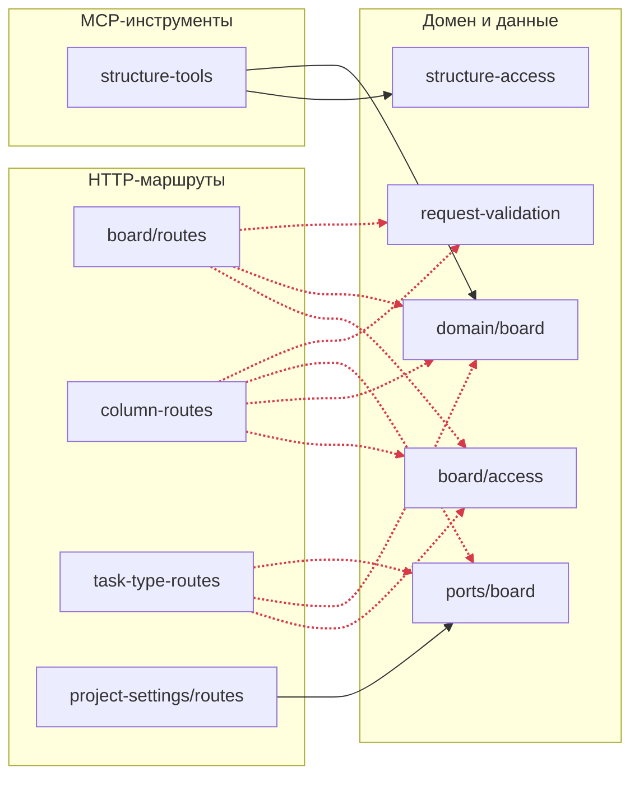
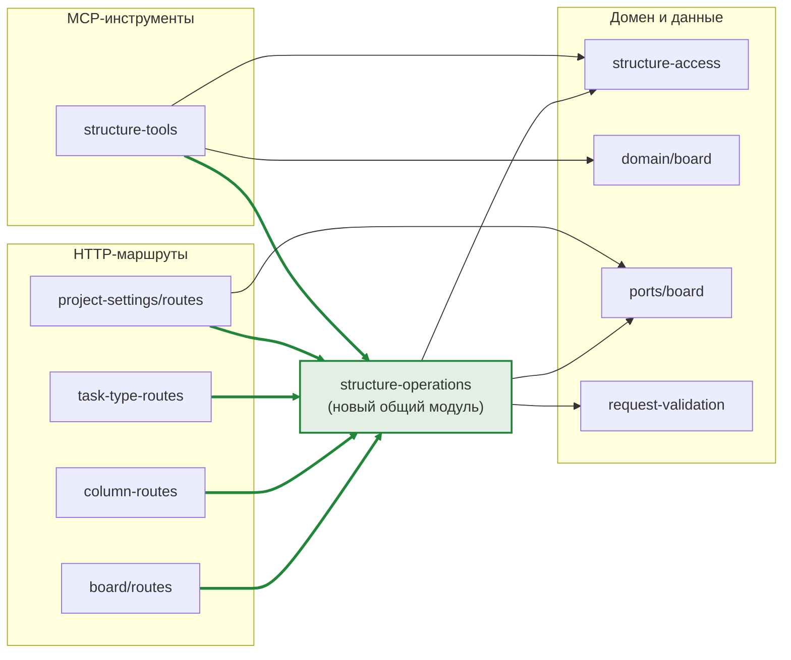

# Пример: от сырого графа к диаграмме для PR

Реальный рефакторинг: «вынести операции со структурой доски в общий модуль для HTTP и MCP».
`deps.mjs` на этом коммите выдал 34 узла и около 100 связей. Читать такой граф невозможно, поэтому его
доводят вручную до истории в одну мысль: **раньше каждый вход сам ходил в проверки и хранилище,
теперь все идут через `structure-operations`**.

Что сделано при доводке:

- оставлены только модули, которые рассказывают историю; общие хелперы (`uuid`, `request-security`,
  `commands`) убраны, потому что они не менялись и есть у всех;
- входы сгруппированы в `subgraph` по слоям (HTTP, MCP), зависимости в слой «домен и данные»;
- в «Было» удалённые связи нарисованы красным пунктиром, в «Стало» новый модуль и новые связи зелёным;
- подписи узлов короткие, без путей: путь знает дифф, а диаграмма показывает смысл;
- id узлов в «Было» и «Стало» одинаковые (`board`, `columns`, …): по ним `diagram.mjs` считает, что
  добавилось и что пропало, поэтому `linkStyle` и `classDef` ниже нужны только для нативного
  предпросмотра Mermaid, а рендерер их игнорирует.

Рендер: сохрани блоки в `deps.md` и запусти
`node $SKILL/scripts/diagram.mjs --md deps.md --out docs/pr/<slug>/05-deps.png --title "Структура доски" --theme both`.

### Было

### Стало

Под диаграммами в PR одна-две фразы: «Логика изменения колонок, типов задач и настроек проекта жила
в каждом маршруте отдельно и дублировалась в MCP. Теперь она в `structure-operations`, а HTTP и MCP
только переводят запрос в вызов операции».
