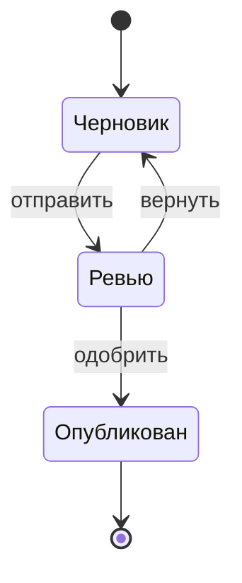
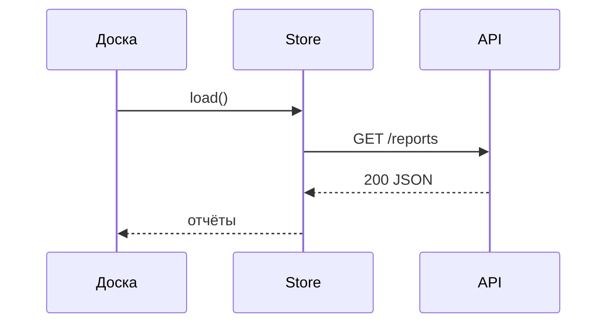
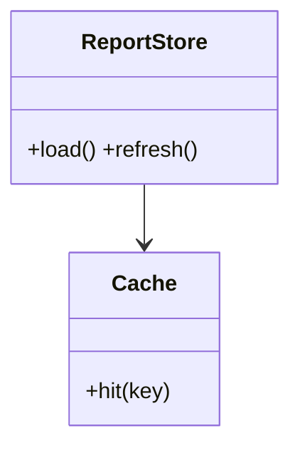
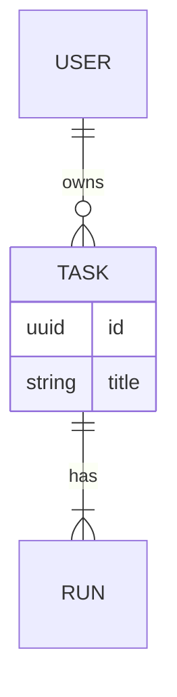
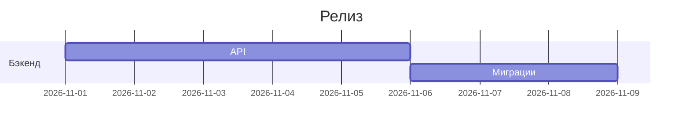
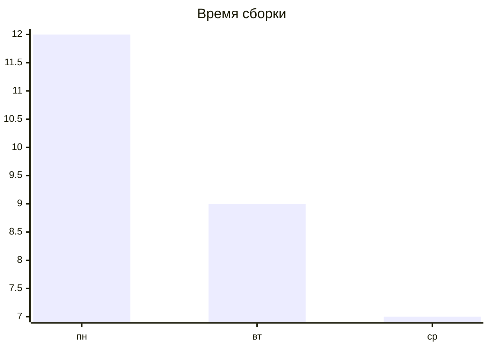

# Типы диаграмм (pele)

`diagram.mjs` рисует через [pele](https://pele.run): синтаксис Mermaid, своя раскладка и стиль.
Все примеры ниже проверены рендером. Остальные типы (agentflow, wardley, cynefin, ishikawa,
railroad, usecase, event modeling) с примерами есть на https://pele.run/examples, проверять
синтаксис удобно в https://pele.run/playground.

Сначала реши, какую одну мысль должна донести схема, потом выбирай тип. Подписи узлов — на языке PR,
id узлов — латиницей и одинаковые в «было» и «стало» (по ним считается дифф).

## Что изменилось в коде

| История | Тип | Дифф «было/стало» |
|---|---|---|
| Кто от кого зависит, новый слой, модуль вынесен | `flowchart LR` + `subgraph` | узлы, связи, подписи, переезд между subgraph |
| Как идёт запрос/вызов между частями | `sequenceDiagram` | участники (сообщения — нет) |
| Жизненный цикл сущности, статусы, переходы | `stateDiagram-v2` | состояния и их подписи |
| Классы, интерфейсы, методы | `classDiagram` | классы (поменялся набор методов → «изменён»), связи |
| Схема БД, миграции | `erDiagram` | сущности (поменялись поля → «изменён»), связи |
| Структура папок/файлов | `treeView-beta` | — |
| Кто за что отвечает (люди, сервисы, агенты) | `swimlane-beta LR` | как у flowchart |
| Инфраструктура, сервисы, базы | `architecture-beta` | сервисы |
| Контекст системы для нового человека | `C4Context` | — |
| Раскладка экрана/блоков | `block` | — |
| Ветки и мерджи | `gitGraph` | — |
| Формат пакета/бинарной структуры | `packet` | — |
| Требования и их проверка | `requirementDiagram` | — |

## Планы, процессы, цифры

| История | Тип |
|---|---|
| План работ по дням | `gantt` |
| Этапы во времени | `timeline` |
| Путь пользователя и его оценка | `journey` |
| Карточки по колонкам | `kanban` |
| Разбор темы, идеи | `mindmap` |
| Доли целого | `pie`, `treemap-beta` |
| Потоки и объёмы | `sankey` |
| Ряды чисел | `xychart` |
| Сравнение по осям | `radar-beta`, `quadrantChart` |
| Пересечение множеств | `venn-beta` |

## Примеры










```mermaid
swimlane-beta LR
  subgraph Агент
    a[Правка]
  end
  subgraph iv3
    b[Отчёт]
  end
  a --> b
```






## Подводные камни

- Не-ASCII подписи в `xychart` и текст в `requirementDiagram` бери в кавычки, иначе ошибка лексера.
- `classDef`, `style`, `linkStyle` рендерер выкидывает: цвета диффа он ставит сам. Пометить узел
  flowchart вручную — `class api changed` (или `added` / `removed`).
- Дифф считается, только если «было» и «стало» одного типа. Flowchart → sequence — это две картинки.
- `--layout unified` (один граф с наложенным диффом) работает только для flowchart.
