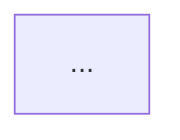

# Шаблон описания PR

Ниже структура на русском. Если PR пишется на другом языке, переведи заголовки, alt-текст и подписи
целиком, не смешивай языки. Английские заголовки: `Task`, `What changed`, `Before → After`, `Before`,
`After`, `Why`, `Dependencies: before → after`, `Diagram source (Mermaid)`, `Testing`; alt-текст
начинается с `Before:` / `After:`.

Блоки, которые не подходят к типу изменения, удаляй целиком, а не оставляй пустыми.

Медиа указывай **путями из репозитория** (`docs/pr/<slug>/01-reports-after.png`). `publish.mjs` сам
заменит их на ссылки по SHA коммита и обновит PR. До его запуска картинки в превью не видны — так и
должно быть.

````markdown
**Задача:** <ссылка на тикет или макет; одной строкой, что просили>

## Что сделано

- <изменение 1: что стало возможно или что исправлено, с точки зрения пользователя>
- <изменение 2>

## Было → Стало

### <Сцена 1: например, «Отчёты: экспорт»>

> **Зачем:** <какое требование задачи подтверждает сцена: «п. 3 тикета — выгрузка в CSV»>


<одно предложение: на что смотреть, если по картинке это не очевидно>

### <Сцена 2: сценарий>

> **Зачем:** <требование>

**Было**


**Стало**


## Зависимости: было → стало

<!-- только для технических задач и рефакторинга; картинка из diagram.mjs -->

<1–2 предложения: что было не так со структурой и что изменилось>

<picture>
  <source media="(prefers-color-scheme: dark)" srcset="docs/pr/<slug>/05-deps-dark.png">
  " src="docs/pr/<slug>/05-deps.png">
</picture>

<details><summary>Исходник диаграммы (Mermaid)</summary>



</details>

## Проверка

- `<команда тестов>` — <результат>
- <ручная проверка: какие сценарии, темы, ширины экрана>
````

## Подписи

- Alt-текст начинается с «Было:» или «Стало:» и описывает, что видно на кадре. Он появляется, если
  картинка не загрузилась, и его читают скринридеры.
- «Зачем» ссылается на требование задачи (пункт тикета, экран в Figma, шаги из бага), а не повторяет
  картинку. Если требования нет, а изменение — твоё решение по ходу работы, так и напиши и объясни
  почему: ревьюер должен отличать заказанное от инициативы.
- Подпись к сцене объясняет, на что смотреть, а не пересказывает картинку.
- Для рефакторинга сцена называется «визуально без изменений», и пара кадров это подтверждает.
- Если для сцены нет «Было» (новая страница, которой раньше не было), карточка не нужна: покажи
  «Стало» отдельной картинкой с подписью «страницы раньше не было» и кадр того, откуда пользователь
  на неё попадает: пункт меню, кнопку.

## Размещение кадров

- **GIF «Было» и «Стало» всегда идут друг под другом во всю ширину**, а не в таблице. В таблице
  каждая ячейка на GitHub получает около 430px, и запись превращается в мелкую мыльную картинку.
- Пара скриншотов — одна карточка из `pair.mjs` (одна картинка на сцену). Она сама выбирает, ставить
  кадры рядом или друг под другом, и с `--diff` обводит изменения. Alt-текст карточки начинается с
  «Было → Стало:» и описывает разницу.
- Если важен контекст целого экрана, положи полные кадры под карточкой в
  `<details><summary>Полные экраны</summary> … </details>`.
- GIF в портретной ориентации (≈360–390px) можно ставить рядом в таблице: они узкие.

## Диаграммы

- В PR кладётся PNG из `diagram.mjs`, а исходник Mermaid уходит в свёрнутый `<details>`: так
  ревьюер видит одинаковую картинку везде, а исходник можно поправить в следующем коммите.
- `<picture>` с тёмной версией работает на GitHub. GitLab `<picture>` не понимает, там оставляй
  только `` светлой версии: карточка непрозрачная и читается в любой теме.
